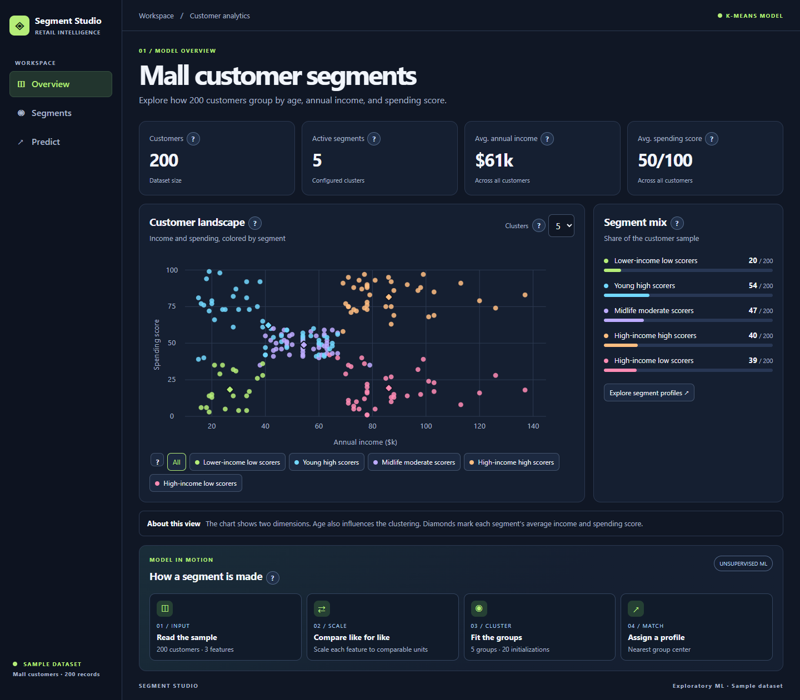
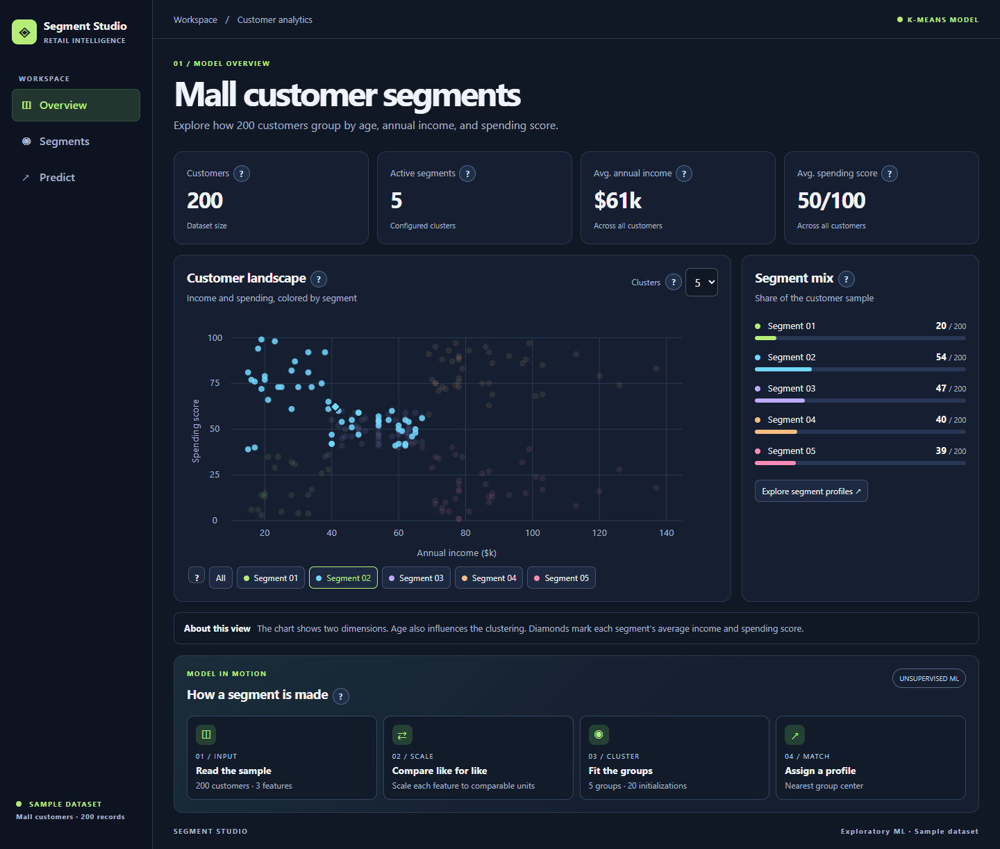
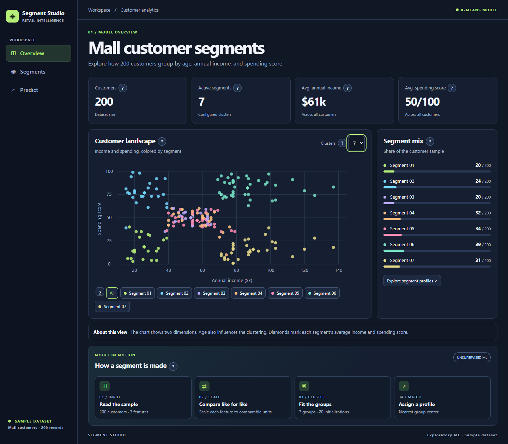
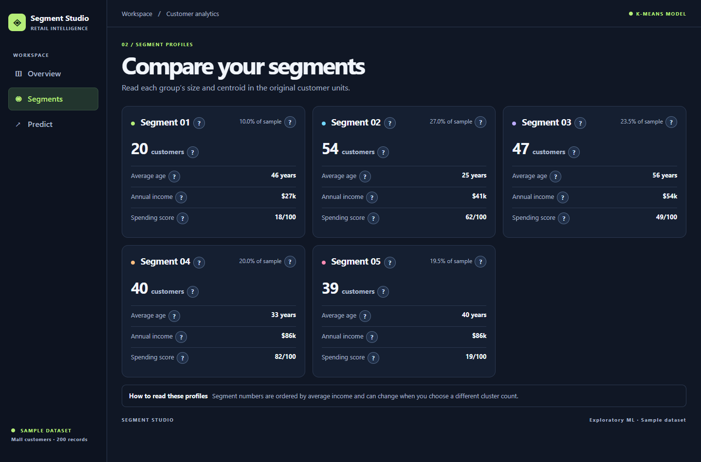
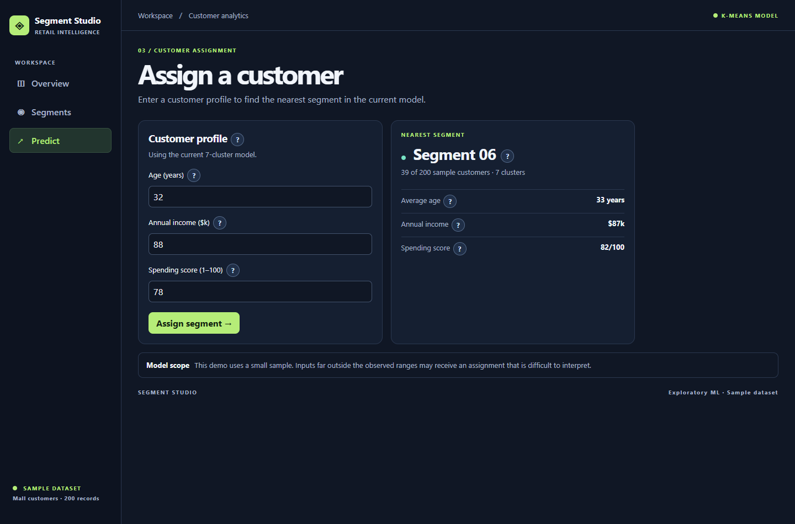
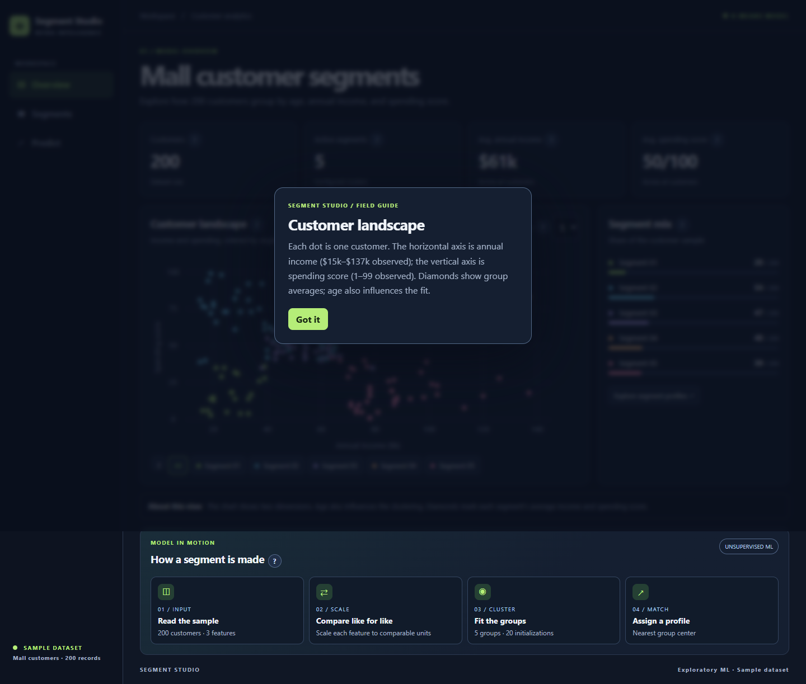
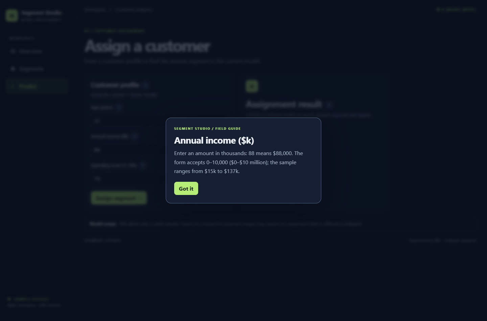
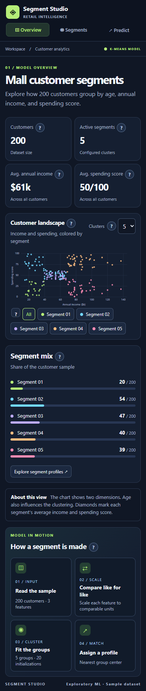
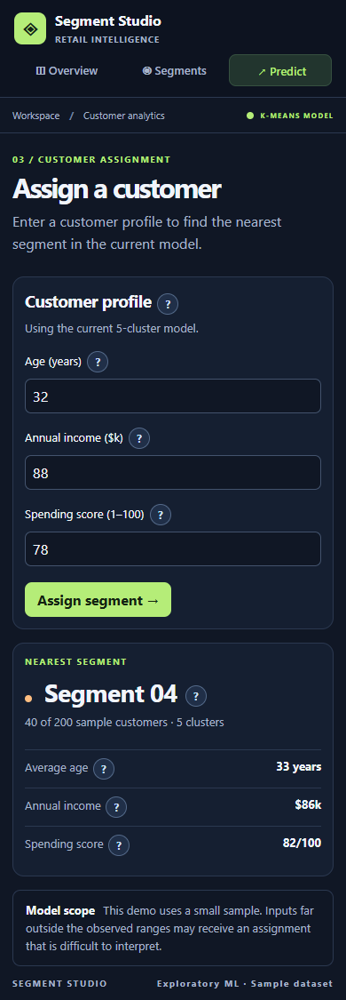
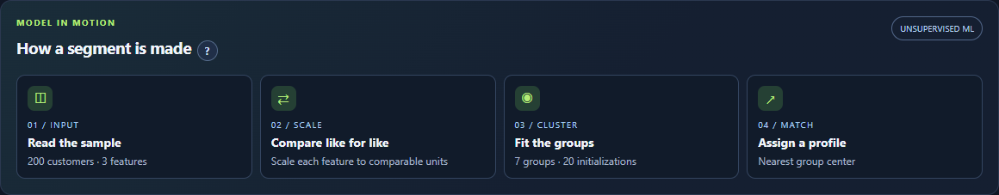

# Segment Studio · Mall Customer Segmentation

[**Open the live Vercel demo →**](https://ml-customer-segmentation-mall.vercel.app)

Segment Studio is an **unsupervised machine learning (ML)** project. Its interactive dashboard uses K-Means to explore how 200 sample mall customers group by age, annual income, and spending score. The browser fits the model locally; customer profiles entered into the app are neither stored nor sent to a server.



## Explore the product

- **Overview:** see sample averages, compare 2–8 clusters, and isolate any group in the income vs. spending chart. Each diamond marks the displayed coordinates of a fitted centroid; age is the third model feature.
- **Segments:** compare each segment’s customer count, sample share, and typical age, income, and spending score in original units.
- **Predict:** enter a profile to find the nearest segment in the current fit. The form validates each field before assigning a group.
- **Field guide:** select a **?** to see what a label or control means, including its units and relevant ranges. Press **Escape** or select **Got it** to close and return focus to the control.
- **Model walkthrough:** follow the four-step infographic from sample data and scaling to grouping and assignment.

## Product screenshots

| Desktop workspace | Desktop workspace |
| --- | --- |
| [Segment focus](docs/screenshots/02-segment-focus.png)  | [Seven-cluster view](docs/screenshots/03-seven-clusters.png)  |
| [Segment profiles](docs/screenshots/04-segment-profiles.png)  | [Customer assignment](docs/screenshots/05-customer-assignment.png)  |
| [Chart field guide](docs/screenshots/08-chart-field-guide.png)  | [Prediction field guide](docs/screenshots/10-prediction-field-guide.png)  |

| [Mobile overview](docs/screenshots/06-mobile-overview.png) | [Mobile assignment](docs/screenshots/07-mobile-assignment.png) |
| --- | --- |
|  |  |



## Model and dataset

The [bundled CSV](archive/Mall_Customers.csv) contains 200 customer rows. The original source and redistribution license are not recorded in the supplied project files.

| Field | Observed sample values | Model role |
| --- | --- | --- |
| Age | 18–70 years | Fit and prediction |
| Annual income | $15k–$137k | Fit and prediction |
| Spending score | 1–99, on a defined scale of 1–100 | Fit and prediction |
| CustomerID | 200 unique identifiers | Record identity only |
| Genre | Categorical field in the source CSV | Excluded |

The model standardizes the three features, fits K-Means with 20 seeded initializations per candidate fit, and assigns each record to the nearest centroid in standardized space. Segment numbers are ordered by centroid income and can change when the cluster count changes. Five is an exploratory starting point. The notebook also compares inertia and silhouette scores across 2–8 clusters. The browser and scikit-learn use different initializers; exact assignments can differ.

This small sample supports exploration. An assignment does not express confidence or validate a business segment, especially for inputs outside the observed ranges.

## Design system

The UI uses a **midnight navy** canvas (`#101725`), **slate** panels (`#151F31`), and **lime** accents (`#B5ED78`) for active navigation, focus, and primary actions. Segments use a separate categorical palette carried through plots, bars, profiles, and results. Labels and counts supplement the colors. The workspace switches to stacked cards and compact navigation on mobile.

## Run and test locally

Use Node.js 24 or newer for the web app.

```sh
npm ci
npm run dev
npm run build
npm test
npx playwright install chromium
npm run test:e2e
```

Model tests cover all supported cluster counts, centroid means, reproducibility, identifier exclusion, and invalid inputs. Browser tests cover segment filtering, refitting, profiles, prediction and validation, mobile layout, keyboard navigation, field-guide ranges and focus restoration, and the live infographic. To regenerate screenshots, set `CAPTURE_SCREENSHOTS=1` before running the browser tests.

Open the [executed Python notebook](Customer-Segmentation-Mall.ipynb) from the repository root:

```sh
python -m pip install -r requirements.txt
python -m notebook Customer-Segmentation-Mall.ipynb
```

The web app is a static Vite build deployed to Vercel. To update the linked project from an authenticated checkout, run `npx vercel deploy --prod`. GitHub auto-deploy requires a separate GitHub login connection in Vercel.

## Source map

- `src/model.js` — CSV validation, scaling, K-Means, and nearest-centroid assignment.
- `src/app.js`, `src/help.js`, `src/style.css` — dashboard, field guide, and design tokens.
- `tests/` — model and browser checks.
- `docs/screenshots/` — real product captures.
