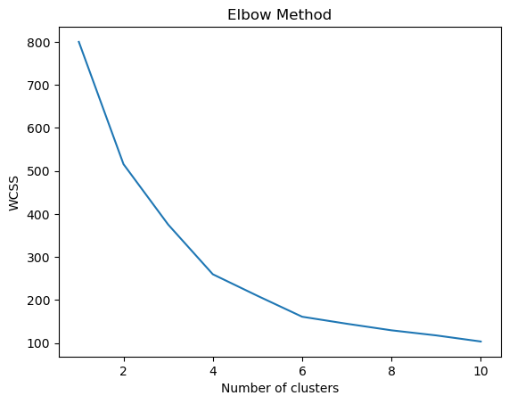

# ML - Customer Segmentation Mall

**Unsupervised machine learning (ML) for exploring customer groups with K-Means clustering.**

This project explores mall customer demographics, annual income, and spending behavior through a Python notebook. It demonstrates data inspection, feature preparation, standardization, cluster exploration, model fitting, visualization, and assigning a sample customer to a segment. Customer groups can provide a starting point for targeted marketing hypotheses and customer engagement planning.



*Project image extracted from the notebook's saved output: within-cluster sum of squares (WCSS) across candidate cluster counts.*

## ML or DL?

This is a **machine learning (ML)** project, specifically **unsupervised learning / clustering**. It uses scikit-learn's K-Means to group records without labeled target outcomes. It is **not deep learning (DL)**: no neural networks or deep learning frameworks are used.

## Dataset

`archive/Mall_Customers.csv` contains **200 records and five columns**:

| Column | Description | Current model usage |
| --- | --- | --- |
| `CustomerID` | Customer identifier | Included as a numeric feature |
| `Genre` | Categorical gender field, using the CSV's original name | Encoding demonstrated separately; excluded from clustering |
| `Age` | Customer age | Included |
| `Annual Income (k$)` | Annual income in thousands of dollars | Included |
| `Spending Score (1-100)` | Dataset spending score | Included |

The notebook checks dataset shape, missing values, and categories. The original dataset source and redistribution license are not recorded in the supplied files; no specific provenance or license is asserted here.

## Methodology

1. Load the CSV with pandas and inspect the data.
2. Drop `Genre` to create a numeric feature matrix.
3. Standardize the numeric features using `StandardScaler`.
4. Demonstrate one-hot encoding of `Genre` separately.
5. Fit K-Means for 1–10 clusters and plot inertia using the elbow method.
6. Fit a five-cluster model with `init='k-means++'` and `random_state=42`.
7. Append cluster labels to the dataframe in memory and visualize segments.
8. Scale a sample customer record and predict its cluster assignment.

Cluster identifiers are arbitrary labels, not customer rankings or validated business categories.

## Technology

- Python and Jupyter Notebook
- pandas and NumPy for data handling
- scikit-learn for preprocessing and clustering
- Matplotlib for visualization
- Seaborn, imported in the notebook

## Run locally

```bash
git clone https://github.com/vams2krish/ML-Customer-Segmentation-Mall.git
cd ML-Customer-Segmentation-Mall
python -m venv .venv
```

Activate the environment in Windows PowerShell:

```powershell
.\.venv\Scripts\Activate.ps1
```

Or on macOS / Linux:

```bash
source .venv/bin/activate
```

Install dependencies and launch the notebook:

```bash
python -m pip install -r requirements.txt
jupyter notebook Customer-Segmentation-Mall.ipynb
```

Before running the cells, replace the original machine-specific CSV path with:

```python
customer_dataset = pd.read_csv("archive/Mall_Customers.csv")
```

Run from the repository root using a Python version supported by the scientific packages. Dependencies are unpinned and do not represent a verified runtime environment. The notebook's `sparse_output` argument requires scikit-learn 1.2 or newer.

## Outputs

- Elbow-method chart comparing candidate cluster counts.
- Five cluster labels added to the in-memory customer dataframe.
- A saved customer-segment scatter plot.
- A sample prediction; the stored output reports cluster `3`.

Saved outputs are from an earlier notebook run and have not been regenerated for publication. Five clusters are selected in the code; no silhouette score, stability analysis, or external validation is reported. Assignments can vary with library versions and initialization defaults.

## Known limitations

- **Feature selection:** `CustomerID` participates in clustering. Remove this identifier before drawing business conclusions, since identifiers generally should not determine customer similarity.
- **Plot labels:** the segment scatter plot uses standardized `CustomerID` and `Age` (columns 0 and 1), although its labels say income and spending score. Correct the selected columns or labels before interpreting it.
- **Centroids:** the segment plot references lowercase `kmeans` from the elbow loop rather than the five-cluster `Kmeans` model. Use the five-cluster model's centroids for a consistent plot.
- **Encoding:** the one-hot encoded category values are not combined with the model features.
- **Reproducibility:** explicitly set `n_init` and pin a tested environment to avoid changes in library defaults.
- **Validation:** compare cluster quality, stability, and segment profiles before applying results to business decisions.
- **Scope:** this is an exploratory notebook with a small dataset, not a deployed service or a validated production segmentation system. No trained model export is included.

## Repository structure

```text
ML-Customer-Segmentation-Mall/
├── Customer-Segmentation-Mall.ipynb   # Original exploratory notebook
├── archive/
│   └── Mall_Customers.csv            # Input data
├── docs/images/
│   └── elbow-method.png              # Saved notebook chart
├── requirements.txt                 # Notebook dependencies
├── .gitignore
└── README.md
```

## Potential applications and next steps

After correcting feature selection and plotting, evaluate cluster stability and summarize each segment's demographics, income, and spending patterns. Validated segments could support customer profiling and campaign planning. These are potential applications, not measured business outcomes of the current project.
